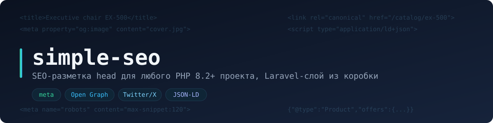

# seotools

Head markup builder for PHP: meta, Open Graph, Twitter/X cards, JSON-LD.

Core is plain PHP 8.2+ with no runtime deps. The Laravel part (provider, facade, `seo()` helper, `@seo` directive) loads only inside a Laravel 11 app.

## Install

```bash
composer require timur-turdyev/seotools
php artisan vendor:publish --tag=seotools-config
```

## Usage

```php
seo()->title('Executive chair EX-500')
    ->description('Ergonomic chair with leather seat.')
    ->image('https://example.com/chair.jpg')
    ->canonical('https://example.com/catalog/chairs/ex-500');
```

Layout head:

```blade
@seo
```

Top-level calls fan out: `title()` fills meta, og and twitter at once, `canonical()` mirrors into `og:url`. Repeated scalar calls replace the value, list-like calls append.

Per-section access when you need it:

```php
seo()->meta()->noindex()->maxSnippet(120)->alternate('ru', 'https://example.com/ru');
seo()->openGraph()->type('article')->property('article:published_time', $date);
seo()->twitterCard()->card(TwitterCardType::SummaryLargeImage);
seo()->jsonLd()->add(['@type' => 'WebSite', 'name' => 'Example']);
```

The twitter section stays silent until the page sets an explicit value, since X reads og tags anyway. Every `jsonLd()->add()` is its own entity; several of them come out as one `@graph`.

Typed builders exist for Product, Offer, AggregateOffer, AggregateRating, Article, BlogPosting, Person, BreadcrumbList, Organization, WebSite, LocalBusiness:

```php
use TimurTurdyev\Seotools\JsonLd\Schema\Schema;

seo()->jsonLd()->add(
    Schema::product()->name('EX-500')->offers(
        Schema::offer()->price('49900.00')->priceCurrency('RUB')->inStock()
    )
);
```

A model can hand over its whole payload through the `HasSeo` contract and `SeoData` value object, then a controller does `seo()->apply($model)`.

Config values act as fallbacks at render time and never overwrite what the page set. `seo()->meta()->withoutDefaults()` turns them off for one page. With `app.debug` on, `@seo` prints an html comment telling which field came from the page and which from config.

Without Laravel, build the manager by hand and call `render()` and `reset()` yourself; see `SeoManager`.

Coming from artesaos/seotools? Read `docs/migration-from-artesaos.md`.

## Checks

`composer test`, `composer analyse`, `composer lint`.

MIT license, see LICENSE.
